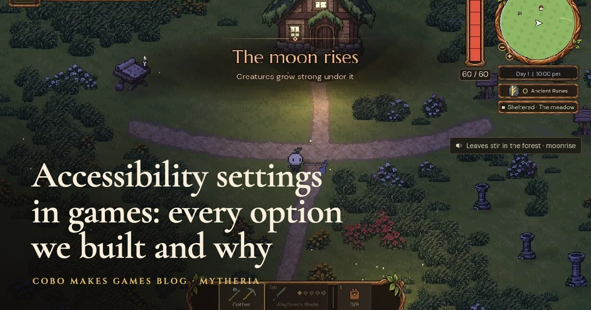

# Hold To Confirm for Godot 4



A button for actions players shouldn't trigger by accident, like spending a lot, deleting a save or quitting without saving. The player holds it until a thin line along its bottom edge fills; letting go early cancels and the line drains away. For players who can't hold a button down, the same button can work as "press twice": the first press arms it, and a second press within a few seconds confirms.

It's the confirm button from [Mytheria](https://cobomakesgames.com/mytheria/), our pixel-art co-op game, where forging, building and big shared spends need a hold. Why we offer both modes, with a version you can try in the browser, is in [accessibility settings in games](https://cobomakesgames.com/blog/accessibility-settings-in-games/).

## What it does

- Hold mode: a 0.6-second hold by default, with the label going from "Hold to forge" to "Keep holding…". An early release emits `cancelled` and the line drains in 0.15 seconds.
- Press-twice mode: "Forge" becomes "Press again to forge" for 3 seconds after the first press.
- Mouse, touch, keyboard and controller all work: on the focused button, holding Enter, Space or the controller's accept button (`ui_accept`) is the same as holding the mouse.
- Reduced motion drops the drain animation and the one-pixel press nudge. The fill still shows progress, because it's information.
- `confirmed` fires exactly once per confirmation.

## Install

Copy `addons/hold_to_confirm` into your project's `addons` folder and enable **Hold To Confirm** under Project Settings > Plugins. Godot 4.3 and later (tested on 4.6 and 4.7).

## Use

Add a `HoldToConfirmButton` where you'd use a `Button`, set its `verb`, and connect `confirmed` instead of `pressed`:

```gdscript
@onready var forge: HoldToConfirmButton = $Forge

func _ready() -> void:
	forge.confirmed.connect(_forge_weapon)
	# From your accessibility settings:
	forge.mode = HoldToConfirmButton.Mode.PRESS_TWICE if settings.press_twice else HoldToConfirmButton.Mode.HOLD
	forge.reduced_motion = settings.reduced_motion
```

Settings: `verb`, `mode`, `hold_seconds` (0.6), `drain_seconds` (0.15), `arm_seconds` (3), `fill_color`, `fill_height` and `reduced_motion`. Call `cancel()` to reset the button, for example when the menu closes.

Use it only for actions that can't be taken back. A hold on every button makes the whole game feel slow; in Mytheria, storing or taking one item is still a single press.

## Demo and tests

Run the project in this repository for the demo. The checks run with:

```
godot --headless --path . --script tests/test_hold_to_confirm.gd
```

## License

MIT, by [Cobo Makes Games](https://cobomakesgames.com). If it helps your game, we'd love to hear about it.
